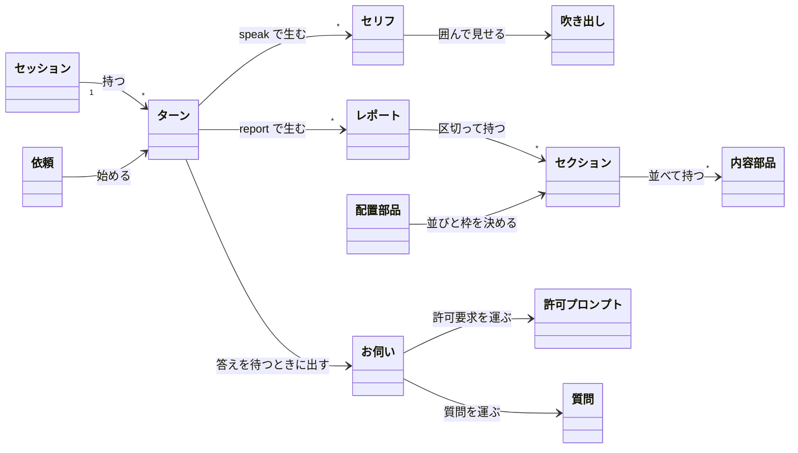
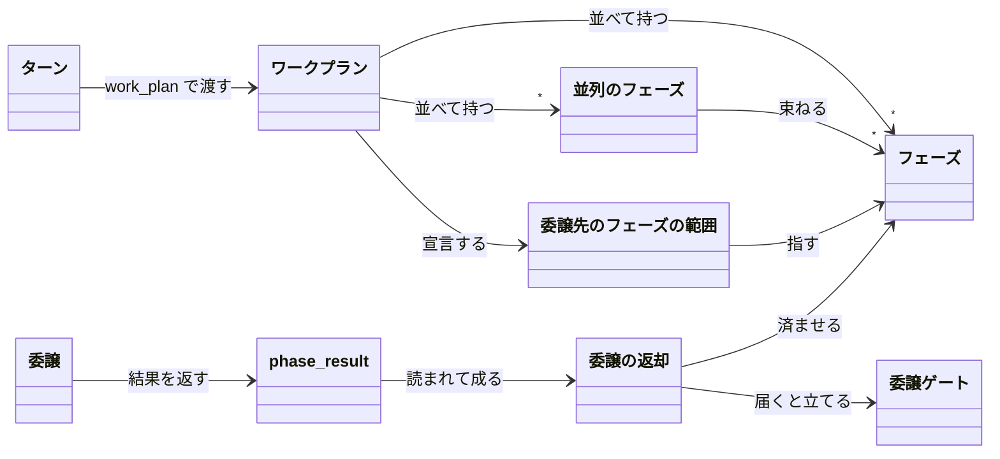
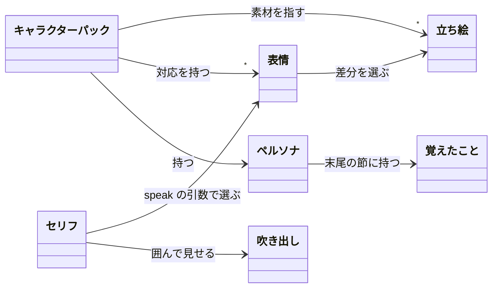

# 用語の関係図

ステータス: **図解**（正典は各図の直後の表に名指す文書。規則を言い直さない）。入口は `docs/guide.md`。

責務: 会話・作業・キャラクターの3つのまとまりについて、主な用語どうしの関係を図で持つ。
読む時: 用語集の語がどう繋がるかを、最初に地図として掴みたいとき。
直す時: 用語どうしの関係（持つ・生む・指す）が変わったとき、主な用語を足したとき。

語の定義は書き写さない。各表の「用語集」の列にある子が正典。矢印の動詞は用語集の定義と注記で裏の取れるものだけを書く。

## 1. 会話のまとまり

セッションの中で、利用者の依頼1つに対するターンが、セリフとレポートを生む。

| 語             | 1行の意味                                        | 用語集                                              | 主な型                                                                           |
| -------------- | ------------------------------------------------ | --------------------------------------------------- | -------------------------------------------------------------------------------- |
| セッション     | SDK の `query` 1つ。tsukumo 1プロセスに1つ       | `docs/glossary/session-and-plan.md`                 | `src/shared/session/session-state.ts`（`SessionState`）                          |
| ターン         | 利用者の依頼1つに対する応答のまとまり            | `docs/glossary/turn.md`                             | `src/shared/session/turn.ts`（`Turn`）                                           |
| 依頼           | ターンの頭に立つ、利用者の入力1つ                | `docs/glossary/conversation-phase.md`（依頼の全文） | `src/shared/session/turn.ts`（`TurnRequest`）                                    |
| セリフ         | `speak` ツールの `text`。会話のための言葉        | `docs/glossary/speech.md`                           | `src/shared/session/turn-speech.ts`（`Speech`）                                  |
| 吹き出し       | セリフ1件を囲って見せる表示                      | `docs/glossary/speech.md`                           | `src/browser/components/page/conversation/components/character-view/balloon.tsx` |
| レポート       | ターンの本文（詳細）を表示単位として呼ぶ名前     | `docs/glossary/detail-and-report.md`                | `src/shared/session/session-event-report.ts`（`ReportEvent`）                    |
| セクション     | レポートの本文を区切る1段                        | `docs/glossary/block.md`                            | `src/shared/report/report-block.ts`（`ReportBlockSection`）                      |
| 内容部品       | セクションの中に並ぶ、中身を持つ本文の1単位      | `docs/glossary/block.md`                            | `src/shared/report/report-block.ts`（`ReportBlock`）                             |
| 配置部品       | 並びや枠を決める部品（`Row`・`Card`・`Section`） | `docs/glossary/block.md`                            | `src/shared/report/a2ui-basic-part-list.ts`                                      |
| お伺い         | 許可要求と質問を同じ形で出すカード               | `docs/glossary/conversation-phase.md`               | `src/shared/session-driver/pending-ask.ts`（`PendingAsk`）                       |
| 許可プロンプト | ツールを実行してよいかを利用者に尋ねるもの       | `docs/glossary/turn.md`                             | `src/shared/session-driver/pending-ask.ts`                                       |
| 質問           | キャラクターから利用者への質問                   | `docs/glossary/conversation-phase.md`（お伺い）     | `src/shared/session-driver/question.ts`（`Question`）                            |

## 2. 作業のまとまり

作業中のターンで `work_plan` が渡すフェーズの並びと、背景で委譲した先からの返却。

「委譲」は用語集に独立した項が無く、`docs/glossary/delegation.md` の各項（委譲の返却・委譲先のフェーズの範囲・委譲ゲート）の中で、背景のサブエージェントへ仕事を渡すこととして使われている。

| 語                     | 1行の意味                                                         | 用語集                                       | 主な型                                                           |
| ---------------------- | ----------------------------------------------------------------- | -------------------------------------------- | ---------------------------------------------------------------- |
| ワークプラン           | 作業中のターンで `work_plan` が渡す、フェーズの並び               | `docs/glossary/work-plan.md`                 | `src/shared/session/work-plan.ts`（`WorkPlan`）                  |
| フェーズ               | 作業のまとまり1つ                                                 | `docs/glossary/work-plan.md`（ワークプラン） | `src/shared/session/work-plan.ts`（`PlannedPhase`・`WorkPhase`） |
| 並列のフェーズ         | 同時に進めるフェーズの束                                          | `docs/glossary/work-plan.md`                 | `src/shared/session/work-plan.ts`（`PhaseGroup`）                |
| 委譲                   | 背景のサブエージェントへフェーズを任せること                      | `docs/glossary/delegation.md`                | `src/server/session-driver/core/background-delegation.ts`        |
| 委譲先のフェーズの範囲 | 委譲するフェーズの `first` と `count`                             | `docs/glossary/delegation.md`                | `src/shared/session/work-plan.ts`                                |
| phase_result           | 委譲先がフェーズの結果を返すツール                                | `docs/glossary/delegation.md`                | `src/server/work-plan/core/phase-result.ts`（`PhaseResult`）     |
| 委譲の返却             | 委譲先がメインへ返す報告                                          | `docs/glossary/delegation.md`                | `src/shared/session/delegate-return.ts`（`DelegateReturn`）      |
| 委譲ゲート             | 返却のあと、メインが `work_plan` を呼ぶまで作業のツールを拒む関門 | `docs/glossary/delegation.md`                | `src/server/session-driver/core/call-review.ts`（`CallReview`）  |

## 3. キャラクターのまとまり

キャラクターパックが立ち絵・表情・人格を束ね、セリフの表情が立ち絵の差分を選ぶ。

| 語                 | 1行の意味                                                                   | 用語集                       | 主な型                                                                           |
| ------------------ | --------------------------------------------------------------------------- | ---------------------------- | -------------------------------------------------------------------------------- |
| キャラクターパック | 立ち絵の素材・表情の対応・人格を1つのディレクトリで束ねた差し替え可能な定義 | `docs/glossary/character.md` | `src/shared/character-pack/character-definition.ts`（`CharacterDefinition`）     |
| 立ち絵             | キャラビューに出すキャラクターの画像                                        | `docs/glossary/character.md` | `src/shared/character-pack/portrait-image.ts`                                    |
| 表情               | 立ち絵の差分。切り替わるのは `speak` の `expression` 引数だけ               | `docs/glossary/character.md` | `src/shared/character-pack/expression.ts`（`Expression`）                        |
| ペルソナ           | キャラクターパックの `persona.md` が持つ人格の本文                          | `docs/glossary/character.md` | `src/shared/character-pack/persona-section.ts`（`personaBody`）                  |
| 覚えたこと         | `remember` ツールで書き足した、キャラクター自身についての行                 | `docs/glossary/memory.md`    | `src/shared/character-pack/persona-section.ts`（`REMEMBERED_SECTION_HEADING`）   |
| セリフ             | 会話のまとまりの表を参照                                                    | `docs/glossary/speech.md`    | `src/shared/session/turn-speech.ts`                                              |
| 吹き出し           | 会話のまとまりの表を参照                                                    | `docs/glossary/speech.md`    | `src/browser/components/page/conversation/components/character-view/balloon.tsx` |

## 用語集に無く、図に載せなかった語

- タスク（`tw` で扱う作業の単位）: 用語集に項が無いので図に載せていない
