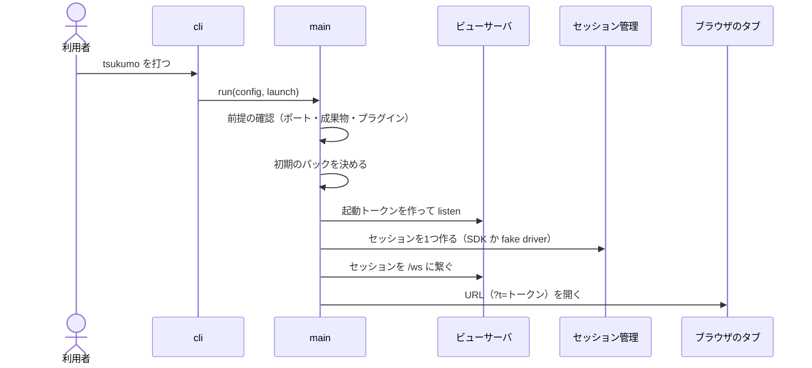
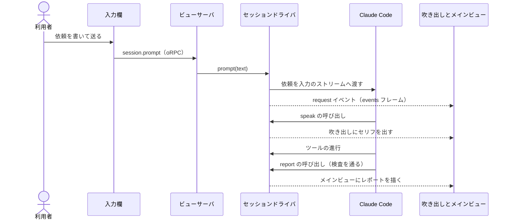
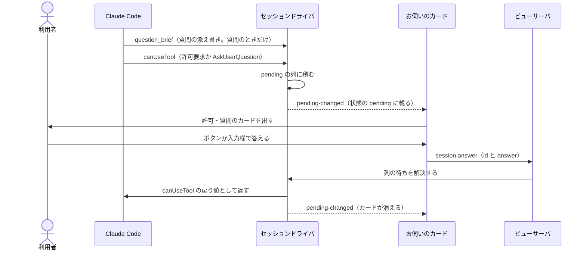
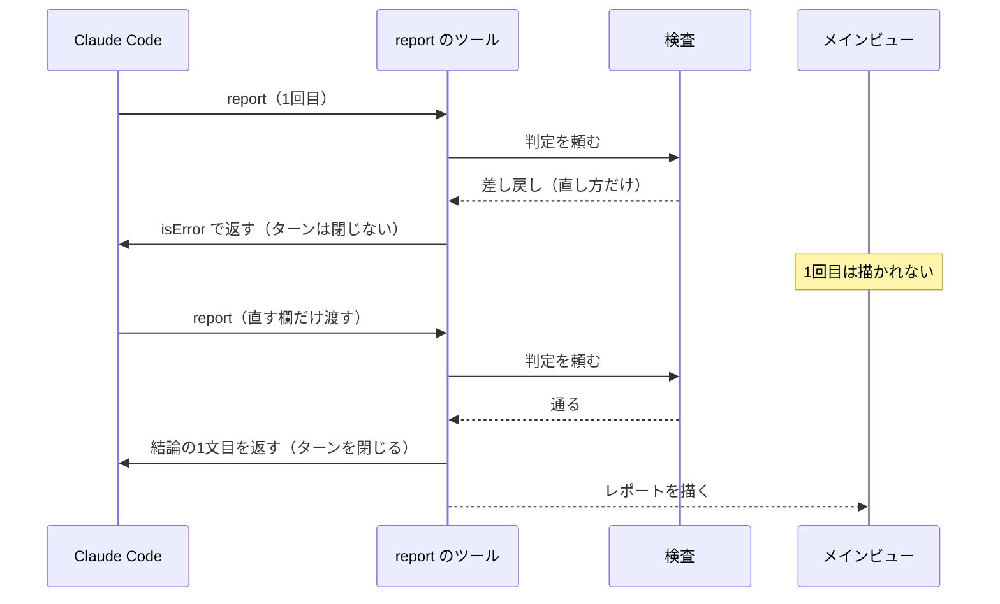

# 会話の基本の流れ

ステータス: **図解**（正典は各図の直後の表に名指す文書。規則を言い直さない）。入口は `docs/guide.md`。

責務: 起動・依頼1件・許可と質問・`report` の差し戻しの4本の流れをシーケンス図で持つ。
読む時: 依頼1件がどう流れて画面に出るかを1本の流れとして掴みたいとき。
直す時: 起動・依頼・答え待ち・`report` の差し戻しの順序が変わったとき。

## 1. 起動

`tsukumo` を打ってから、タブが開くまで。順序の正典は `docs/architecture/runtime-flow.md`「起動」。

箱と実物

| 箱             | 実物                                                                                      | 正典の文書                                  |
| -------------- | ----------------------------------------------------------------------------------------- | ------------------------------------------- |
| cli            | `src/cli.ts`                                                                              | `docs/architecture/runtime-flow.md`「起動」 |
| main           | `src/main.ts`、`src/startup-order.ts`、`src/current-character.ts`、`src/session-start.ts` | `docs/architecture/runtime-flow.md`「起動」 |
| ビューサーバ   | `src/view-delivery.ts`、`src/server/view-server/adapter/server.ts`                        | `docs/architecture/runtime-flow.md`「起動」 |
| セッション管理 | `src/server/session/core/session-manager.ts`、`src/server/session/core/session-launch.ts` | `docs/architecture/runtime-flow.md`「起動」 |
| ブラウザのタブ | `src/browser/`                                                                            | `docs/architecture/runtime-flow.md`「接続」 |

## 2. 依頼1件

入力欄から送った依頼が、セリフとレポートになって画面に出るまで。正典は `docs/architecture/runtime-flow.md`「接続」「依頼」、`docs/architecture/display/speak-tool.md`、`docs/architecture/display/main-view.md`。

箱と実物

| 箱                     | 実物                                                                                                                                                                          | 正典の文書                                          |
| ---------------------- | ----------------------------------------------------------------------------------------------------------------------------------------------------------------------------- | --------------------------------------------------- |
| 入力欄                 | `src/browser/components/page/conversation/components/dispatch/`                                                                                                               | `docs/architecture/runtime-flow.md`「依頼」         |
| ビューサーバ           | `src/server/view-server/adapter/rpc/frame-procedure.ts`、`src/server/session/adapter/session-procedure.ts`                                                                    | `docs/architecture/runtime-flow.md`「接続」「依頼」 |
| セッションドライバ     | `src/server/session-driver/adapter/sdk/sdk-driver.ts`、`src/server/session-driver/adapter/sdk/sdk-speech-tool.ts`、`src/server/session-driver/adapter/sdk/sdk-report-tool.ts` | `docs/architecture/display/speak-tool.md`           |
| Claude Code            | SDK が起こす子プロセス（実物のコードは無い）                                                                                                                                  | `docs/architecture/overview-and-layer.md`           |
| 吹き出しとメインビュー | `src/browser/components/page/conversation/components/character-view/`、`src/browser/components/page/conversation/components/main-view/`                                       | `docs/architecture/display/main-view.md`            |

## 3. 許可プロンプトと質問

ツールの許可と `AskUserQuestion` が入力欄に出て、答えが Claude Code へ戻るまで。正典は `docs/architecture/runtime-flow.md`「答え待ち」と `docs/architecture/display/permission-and-question.md`。

箱と実物

| 箱                 | 実物                                                                                                                                                    | 正典の文書                                             |
| ------------------ | ------------------------------------------------------------------------------------------------------------------------------------------------------- | ------------------------------------------------------ |
| Claude Code        | SDK が起こす子プロセス（実物のコードは無い）                                                                                                            | `docs/architecture/overview-and-layer.md`              |
| セッションドライバ | `src/server/session-driver/core/pending-answer.ts`、`src/server/session-driver/adapter/sdk/sdk-driver.ts`、`src/server/question/core/question-brief.ts` | `docs/architecture/runtime-flow.md`「答え待ち」        |
| お伺いのカード     | `src/browser/components/page/conversation/components/inquiry/`、`src/browser/components/page/conversation/components/pending-ask-card/`                 | `docs/architecture/display/permission-and-question.md` |
| ビューサーバ       | `src/server/session/adapter/session-procedure.ts`                                                                                                       | `docs/architecture/runtime-flow.md`「答え待ち」        |

質問の書き方の条は `src/server/question/core/question-notation.ts` が持つ。

## 4. `report` の差し戻し

検査で差し戻された `report` が描かれず、書き直した `report` が通って描かれるまで。差し戻した草稿は「保留」にならない。イベントは判定の結果まで預かられ、`isError` で返ると捨てられる。正典は `docs/architecture/display/speak-tool.md` の `report` の節。

箱と実物

| 箱              | 実物                                                             | 正典の文書                                |
| --------------- | ---------------------------------------------------------------- | ----------------------------------------- |
| Claude Code     | SDK が起こす子プロセス（実物のコードは無い）                     | `docs/architecture/overview-and-layer.md` |
| report のツール | `src/server/session-driver/adapter/sdk/sdk-report-tool.ts`       | `docs/architecture/display/speak-tool.md` |
| 検査            | `src/server/report/core/review/report-review.ts`                 | `docs/architecture/display/speak-tool.md` |
| メインビュー    | `src/browser/components/page/conversation/components/main-view/` | `docs/architecture/display/main-view.md`  |
