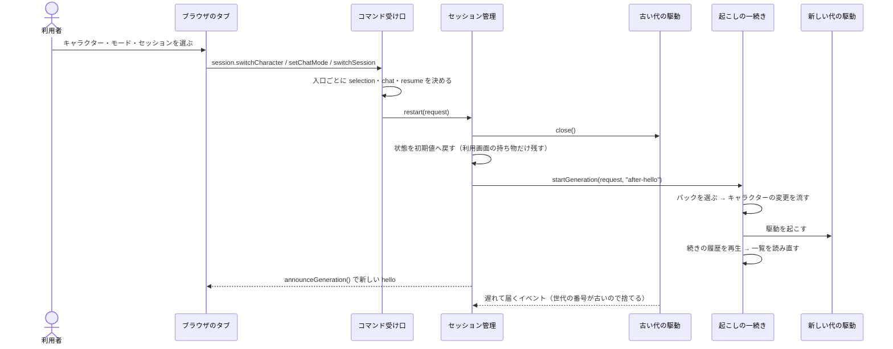
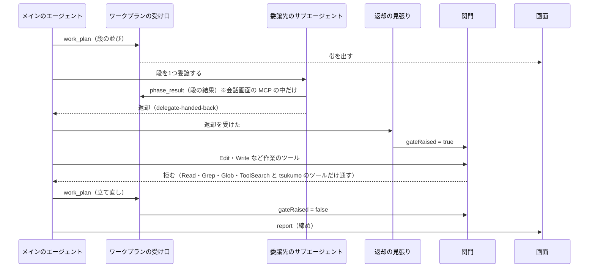
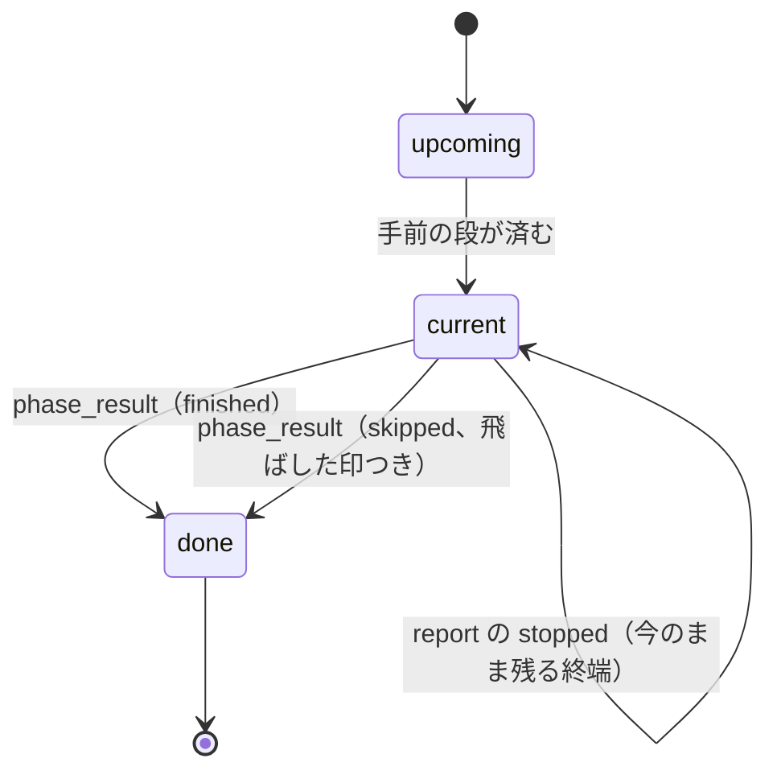

# セッションの起こし直しと委譲の流れ

ステータス: **図解**（正典は各図の直後の表に名指す文書。規則を言い直さない）。入口は `docs/guide.md`。

責務: セッションの起こし直し・タスクの委譲と返却の関門・ワークプランのフェーズの状態を、シーケンス図と状態図で持つ。
読む時: キャラクター・雑談モード・セッションを切り替えたとき何が起きるか、委譲から返却までどの順で進むかを1本の流れとして掴みたいとき。
直す時: 起こし直しの入口や順序、委譲の関門、フェーズの状態の遷移が変わったとき。

## 1. 起こし直し

画面から切り替えを頼むと、3つの入口がどれも `restart` を通って駆動を新しく起こす。正典は `docs/architecture/runtime-flow.md`「起こし直し」、`docs/architecture/session-restore.md`、`docs/architecture/chat-mode/mode-and-switch.md`「切り替え方」。

3つの入口の違い

| 入口                      | パックの選び方             | 続きの探し方                                                             | 断る場合                            |
| ------------------------- | -------------------------- | ------------------------------------------------------------------------ | ----------------------------------- |
| `session.switchCharacter` | 名前で選ぶ（`by name`）    | 探さず新規。雑談かどうかは保つ                                           | なし                                |
| `session.setChatMode`     | いまのまま（`by current`） | 戻す先のモードの直前のセッションが空いていれば続き。無い・使用中なら新規 | なし（使用中は新規に倒す）          |
| `session.switchSession`   | いまのまま（`by current`） | 選んだセッションの ID を `reserveSession` で押さえて続き                 | 使用中なら `sessionOccupied` で断る |

箱と実物

| 箱                   | 実物                                                                                                                                      | 正典の文書                                                     |
| -------------------- | ----------------------------------------------------------------------------------------------------------------------------------------- | -------------------------------------------------------------- |
| ブラウザのタブ       | `src/browser/`                                                                                                                            | `docs/architecture/runtime-flow.md`「起こし直し」              |
| コマンド受け口       | `src/server/session/core/session-command.ts`                                                                                              | `docs/architecture/chat-mode/mode-and-switch.md`「切り替え方」 |
| セッション管理       | `src/server/session/core/session-manager.ts`（`restart`）・`session-generation-start.ts`（`receiveIfCurrent` が世代の番号を比べて捨てる） | `docs/architecture/runtime-flow.md`「起こし直し」              |
| 起こしの一続き       | `src/server/session/core/session-launch.ts`                                                                                               | `docs/architecture/session-restore.md`                         |
| 古い・新しい代の駆動 | `src/server/session-driver/core/session-driver.ts`                                                                                        | `docs/architecture/session-restore.md`                         |

## 2. 委譲と返却の関門

メインがタスクを `work_plan` に立てて委譲し、返ってきたら関門が立つまで。正典は `docs/architecture/workflow-contract/port-and-return.md`。

`phase_result` は会話画面の MCP の中だけで見える。素の CLI からは見えないので、そこでは委譲先の報告が返却の材料になる（`docs/research/phase-result-unavailable-2026-11-05.md`）。

箱と実物

| 箱                      | 実物                                                                                                   | 正典の文書                                                             |
| ----------------------- | ------------------------------------------------------------------------------------------------------ | ---------------------------------------------------------------------- |
| ワークプランの受け口    | `src/server/work-plan/core/work-plan-tool.ts`                                                          | `docs/architecture/workflow-contract/port-and-return.md`「委譲の返却」 |
| `phase_result` の受け口 | `src/server/work-plan/core/phase-result-tool.ts`                                                       | `docs/architecture/workflow-contract/port-and-return.md`「委譲の返却」 |
| 返却の見張り            | `src/server/work-plan/core/work-plan-review.ts`（`delegate-handed-back` で `gateRaised` を立てる）     | `docs/architecture/workflow-contract/port-and-return.md`「委譲の返却」 |
| 関門                    | `src/server/work-plan/core/work-plan-gate.ts`（`judgeToolAgainstGate`・`judgeEditAgainstMissingPlan`） | `docs/architecture/workflow-contract/port-and-return.md`「委譲の返却」 |
| 画面                    | `src/browser/`                                                                                         | `docs/architecture/workflow-contract/port-and-return.md`               |

最初の `work_plan` までは `Edit`・`Write` も拒まれる（`judgeEditAgainstMissingPlan`）。

## 3. ワークプランのフェーズの状態

段の状態は先（`upcoming`）・今（`current`）・済み（`done`）の3つ。止めた状態は独立した値ではなく、`report` の `workPlanClosing: stopped` で今のまま残るもの。

箱と実物

| 状態・遷移                    | 実物                                                                    | 正典の文書                                               |
| ----------------------------- | ----------------------------------------------------------------------- | -------------------------------------------------------- |
| `upcoming`・`current`・`done` | `src/shared/session/work-plan.ts`（`PlannedPhaseState`）                | `docs/architecture/workflow-contract/port-and-return.md` |
| 済み・飛ばした印              | `src/shared/session/work-plan-fold.ts`（`phase-done`・`phase-skipped`） | `docs/architecture/workflow-contract/port-and-return.md` |
| 止めた（今のまま残る）        | `src/shared/session/work-plan.ts`（`WORK_PLAN_CLOSINGS`）               | `docs/architecture/workflow-contract/port-and-return.md` |
