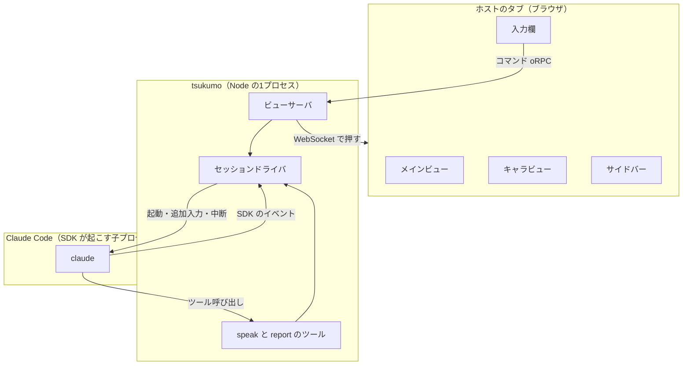
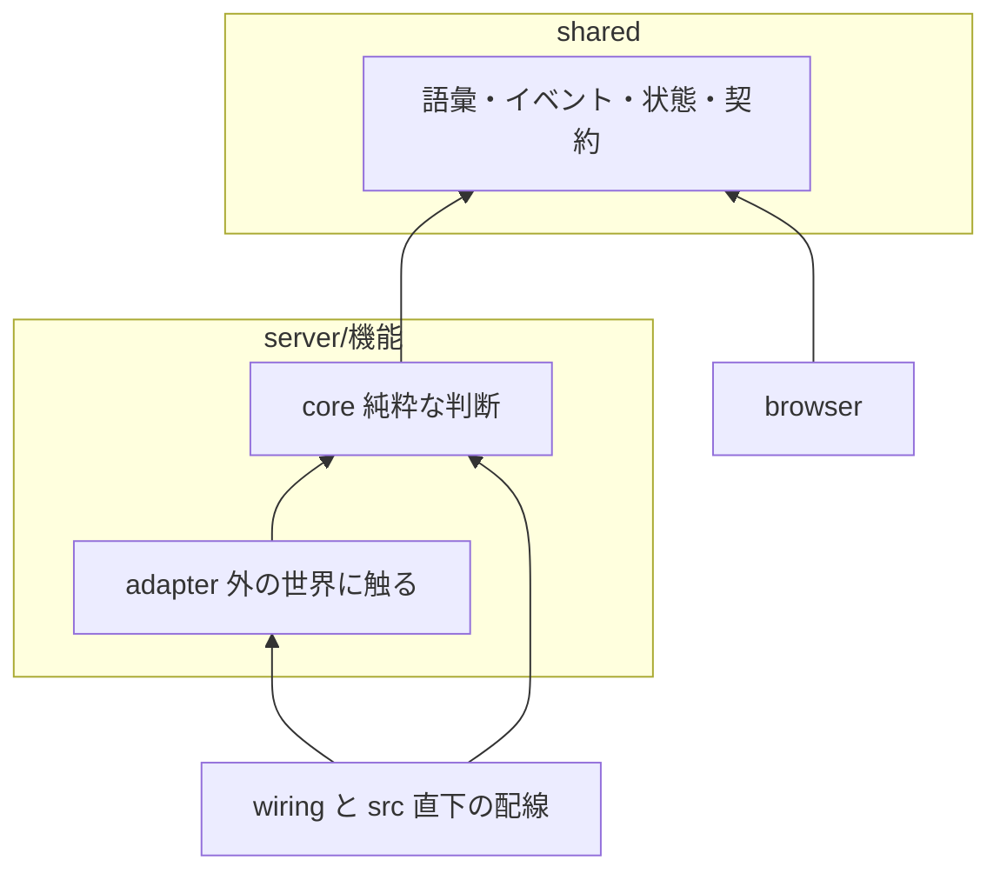
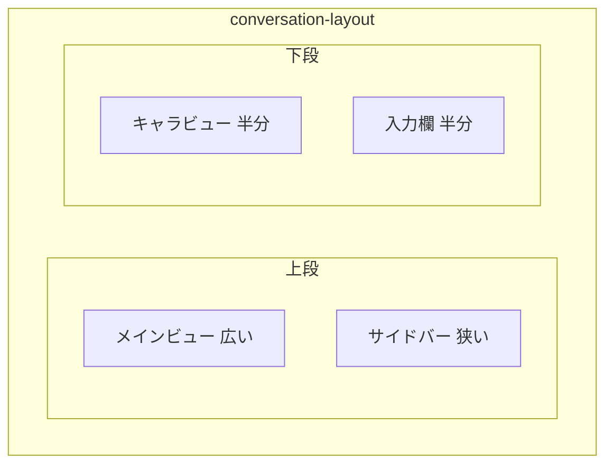
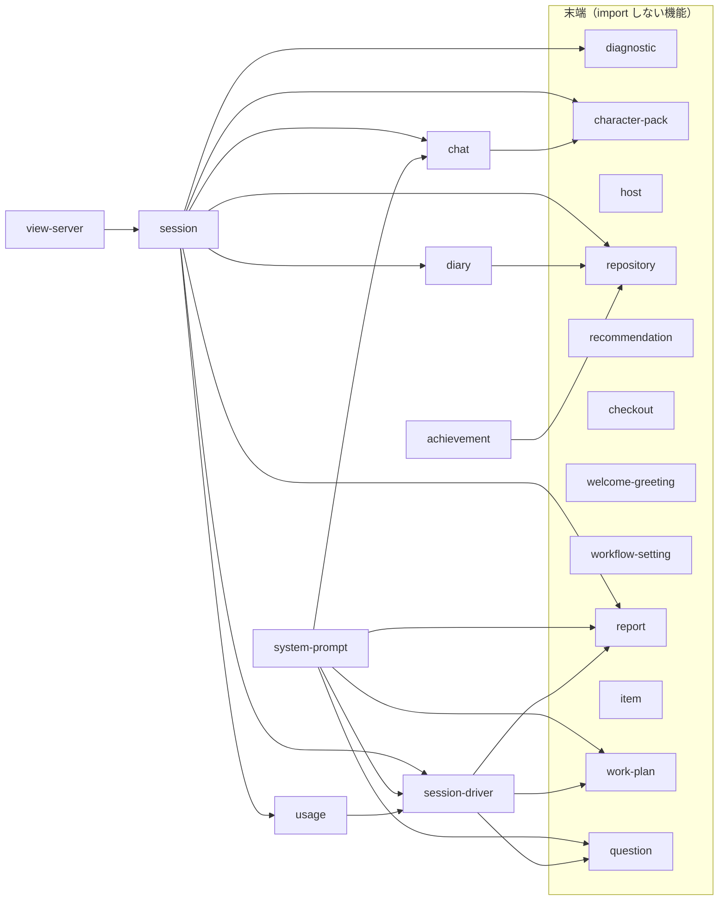

# 全体図

ステータス: **図解**（正典は各図の直後の表に名指す文書）。入口は `docs/guide.md`。

責務: プロセス・層・画面の領域の全体図を持つ。
読む時: リポジトリの全体の構成を図で掴みたいとき。
直す時: プロセスの構成・層の構成・画面の領域が変わったとき。

## 1. プロセスの構成

tsukumo は Node の1プロセスで、Claude Code を SDK の子プロセスとして起こす。ブラウザとは WebSocket 1本でつなぐ。

箱と実物

| 箱                       | 実物                                                                  | 正典の文書                                |
| ------------------------ | --------------------------------------------------------------------- | ----------------------------------------- |
| メインビュー             | `src/browser/components/page/conversation/components/main-view/`      | `docs/requirements/screen-layout.md`      |
| キャラビュー             | `src/browser/components/page/conversation/components/character-view/` | `docs/requirements/screen-layout.md`      |
| サイドバー               | `src/browser/components/domain/sidebar/`                              | `docs/requirements/screen-layout.md`      |
| 入力欄                   | `src/browser/components/page/conversation/components/dispatch/`       | `docs/requirements/screen-layout.md`      |
| ビューサーバ             | `src/server/view-server/`                                             | `docs/architecture/runtime-flow.md`       |
| セッションドライバ       | `src/server/session-driver/`                                          | `docs/architecture/runtime-flow.md`       |
| speak と report のツール | `src/server/session-driver/adapter/sdk/`                              | `docs/architecture/overview-and-layer.md` |

## 2. 層の構成

矢印は import してよい向き。許可の一覧は正典が持つので、ここには書き写さない。

箱と実物

| 箱            | 実物                                                  | 正典の文書                                                           |
| ------------- | ----------------------------------------------------- | -------------------------------------------------------------------- |
| shared        | `src/shared/`                                         | `docs/architecture/overview-and-layer.md`                            |
| core          | `src/server/view-server/core/`（機能ごとに同じ形）    | `docs/architecture/overview-and-layer.md`、`.dependency-cruiser.cjs` |
| adapter       | `src/server/view-server/adapter/`（機能ごとに同じ形） | `docs/architecture/overview-and-layer.md`、`.dependency-cruiser.cjs` |
| browser       | `src/browser/`                                        | `docs/architecture/overview-and-layer.md`                            |
| wiring と配線 | `src/wiring/`                                         | `docs/architecture/overview-and-layer.md`                            |

## 3. ブラウザの画面の領域

`conversation-layout` が4つの領域を1枚のページに組む。

箱と実物

| 箱                  | 実物                                                                       | 正典の文書                           |
| ------------------- | -------------------------------------------------------------------------- | ------------------------------------ |
| conversation-layout | `src/browser/components/page/conversation/components/conversation-layout/` | `docs/requirements/screen-layout.md` |
| メインビュー        | `src/browser/components/page/conversation/components/main-view/`           | `docs/requirements/screen-layout.md` |
| サイドバー          | `src/browser/components/domain/sidebar/`                                   | `docs/requirements/screen-layout.md` |
| キャラビュー        | `src/browser/components/page/conversation/components/character-view/`      | `docs/requirements/screen-layout.md` |
| 入力欄              | `src/browser/components/page/conversation/components/dispatch/`            | `docs/requirements/screen-layout.md` |

## 4. サーバの機能の依存

許された向きの図で、実際の import を数えたものではない。元は `.dependency-cruiser.cjs` の `server-feature-edge:` の規則で、`pnpm run format` が書き直す。

<!-- feature-edge-graph:start -->

<!-- feature-edge-graph:end -->
