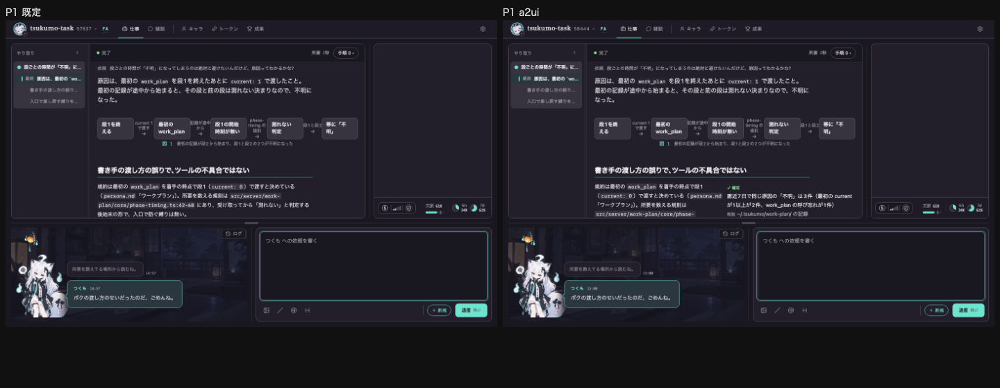
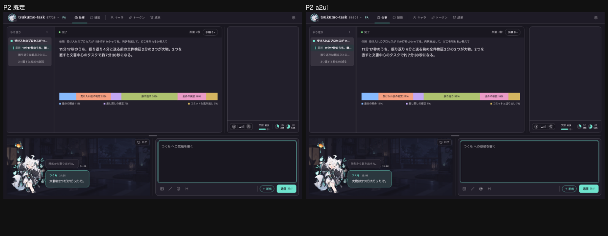
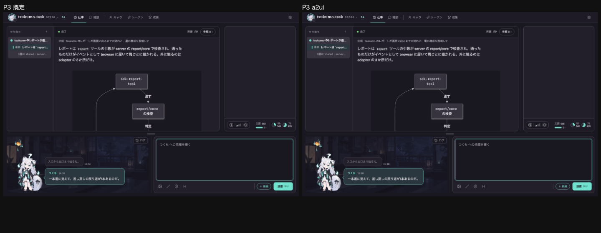
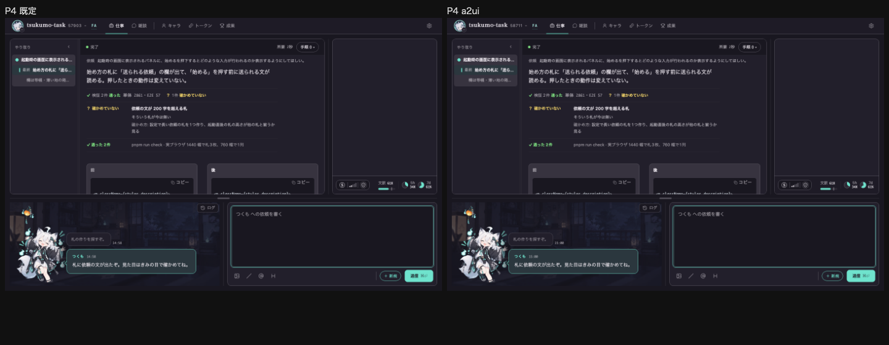
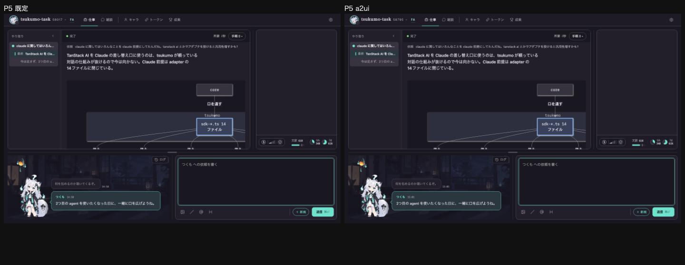
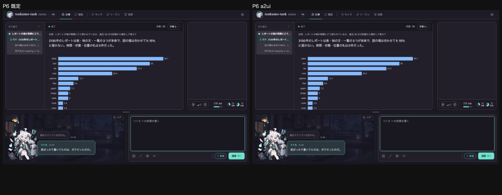
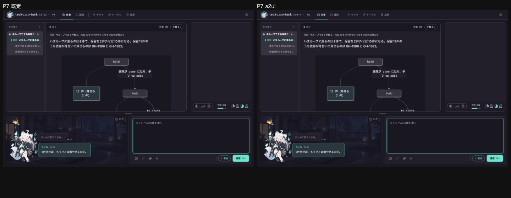
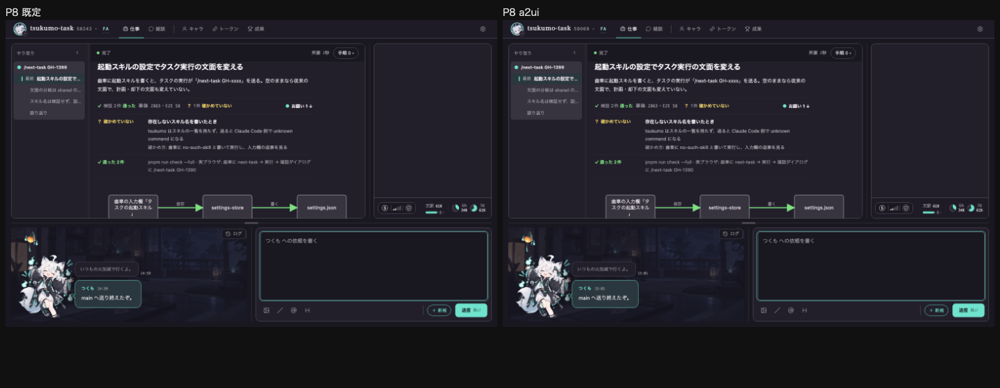
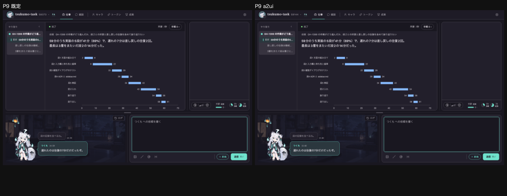

# 既定と `a2ui` の変種を比べる測定（2026-10-28）

ステータス: 一次情報（測定の記録）。既定を切り替えるかの決定は利用者が持つ。この記録は数と画を出すだけで、既定を変えない。

問い:

1. 同じ 9 本（P1〜P9）を既定の変種と `a2ui` の変種で描くと、見た目はどこが違うか。
2. `a2ui` の変種を AI に書かせると、本番の部品でどれだけ通るか。部品の JSON Schema を全部載せるのと、名前の列挙だけにして文法カードを引かせるのとで、ツール定義の字数と通過率はどう違うか。
3. 操作できる部品（`Table` の並べ替え・絞り込みと `ChoicePicker`）を含む題材は、操作無しの題材と通過率が違うか。

## 1. 同じ 9 本の対

撮り方: 主ブランチの疑似セッションの撮影の道具（`scripts/capture/capture-view.ts`）に、`--session` で 9 場面の索引を渡して 1440x900 で撮った。`pnpm run build` のあとの画で、画は最初の 1 画面（本文はメインビューの中でスクロールする）。

9 本が疑似セッションの目録（`fixture/fake-session/`）に実在するのは P5・P7 に当たる 2 本（`row-panel-decision`・`row-panel-status` と `a2ui-row-card-decision`・`a2ui-row-card-status`）だけで、残りの 7 本は 2026-10-28 の比較の作業場所 `/tmp/report-compare/` にあった疑似セッションから撮った。既定の 9 本は `tsukumo-now/`、`a2ui` の 9 本は `a2ui/`（既定の 9 本の引数の中身を変えずに `components` へ写し、横に並ぶ塊を `Row`、枠に入れる塊を `Card` にしたもの。`files`・`dimension` は `Table` に写した）。

| 対  | 違い   | 場所と数（既定 → `a2ui`）                                                                        | 原因                                                                         |
| --- | ------ | ------------------------------------------------------------------------------------------------ | ---------------------------------------------------------------------------- |
| P1  | あり   | 色相の族の内訳が変わる（1 窓目 150°: 62px → 590px、2 窓目 150°: 317px → 54px）。本文の字数は同じ | 隣り合う 2 つの塊を `Row` で横に並べた（写し方）                             |
| P2  | なし   | `--paper-metric`・位置・字数とも差なし                                                           | -                                                                            |
| P3  | あり   | 表が狭く高くなる（幅 481 → 375px、高さ 125 → 185px、左端 410 → 269px）                           | 表が `Row` の中に入った（写し方）                                            |
| P4  | あり   | `files` が `Table` になり、表の要素が 0 → 2 件。本文の字数 1053 → 1206。縦落ちの files 0/1 → 0/0 | `files` → `Table` の写し（部品の描き方）                                     |
| P5  | わずか | 表の上端が 15px 上がる（1247 → 1231）                                                            | `Card` の枠（写し方）                                                        |
| P6  | あり   | 表が横へ移る（左端 525 → 332px）、上端が 21px 下がる（766 → 787）                                | `Row` で横に並べた（写し方）                                                 |
| P7  | わずか | 表の上端が 11px 下がる（1048 → 1059）                                                            | `Card`（写し方）                                                             |
| P8  | あり   | `files` が `Table` になり、本文の字数 1799 → 1637。縦落ちの files 0/1 → 0/0（2 窓とも）          | `files` → `Table` の写し（部品の描き方）                                     |
| P9  | あり   | `sequenceDiagram` の右が切れ、表が幅 491 → 375px・高さ 296 → 416px・上端 1581 → 730px            | 半分の幅の `Row` の中に図を入れた（写し方）。ADR 0039 が書く既知の切れと同じ |

画（左が既定、右が `a2ui`。窓に収まる最初の 1 画面）:

確かめた手:

- 画の目視は P4（最初の 1 画面の対）と P9（表へ転がした画）だけ。ほかの 7 本の差は `--measure`・`--paper-metric` の数の比べで、目では見ていない。
- `a2ui` の 9 本の `components` を `a2uiStructureFaults` に通すと、9 本とも違反 0 件（部品の数は P1 8・P2 9・P3 6・P4 6・P5 6・P6 10・P7 8・P8 8・P9 8、節の数は P3〜P5 が 1、ほかは 2）。
- 9 対で本文の領域の字数が同じなのは P4・P8 を除く 7 本。

## 2. AI に書かせた通過率

道具: `scripts/dev/a2ui-write-trial.ts`（`claude -p --model sonnet --tools "" --disable-slash-commands --setting-sources "" --strict-mcp-config --no-session-persistence`）。題材はすべて架空で、出力の全文はこの記録にもリポジトリにも入れていない。

- 載せ方 A（全部載せ）: system prompt にカタログ文書の JSON Schema を全文で入れる。
- 載せ方 B（名前の列挙＋引く口）: 部品名と 1 行の用途だけを入れ、書き手が `CARD <部品名>` の行を出したら、道具が JSON Schema の断片・参照する `$defs`・例 1 つを返して書き直させる（`report_part_card` の代役。本体のコードには無いので道具の中で組んだ）。
- 題材: T1（A2UI と report の違いの比較）・T2（検索画面の不具合を直した報告）は操作無し。節の数 2・3・4 × 例の有無 = 6 件ずつ。T3（案件の一覧を種別で絞り並べ替える）・T4（検証結果の一覧を状態で絞る）は操作できる部品を使わせる。節の数 2・3 × 例あり = 2 件ずつ。
- 判定: 部品ごとの形（`a2uiReportComponentSchema`）、続けて構造の検査（`a2uiStructureFaults`）。落ちたものは本番の差し戻しと同じ文（`a2uiValidationFailedText` か `Input validation error: …`）を添えて 1 回だけ再試行する。

| 載せ方 | 操作     | 件数 | 一発 | 直った | 直らない | 節の数の一致 | path の整合の違反 | 操作を使った | 呼び出し | 落ちた理由                |
| ------ | -------- | ---- | ---- | ------ | -------- | ------------ | ----------------- | ------------ | -------- | ------------------------- |
| A      | 操作無し | 12   | 12   | 0      | 0        | 12           | 0                 | 0            | 12       | なし                      |
| A      | 操作あり | 4    | 4    | 0      | 0        | 4            | 0                 | 4            | 4        | なし                      |
| B      | 操作無し | 12   | 11   | 1      | 0        | 11           | 0                 | 1            | 25       | schema:not-a-json-array 1 |
| B      | 操作あり | 4    | 4    | 0      | 0        | 4            | 0                 | 4            | 8        | なし                      |

最初の呼び出しは 32 件。B の「呼び出し」が件数の約 2 倍なのは、カードを引いたあとの 2 回目の呼び出しを含むため。落ちた 1 件（`B-T1-n4-noex`）は、最初の出力が JSON の途中で途切れていた。再試行で直った。

ツール定義の字数（`node scripts/dev/a2ui-write-trial.ts --dry-run`）:

| 載せ方               | 字数                                                                                 |
| -------------------- | ------------------------------------------------------------------------------------ |
| A 全部載せ           | 20586                                                                                |
| B 名前の列挙＋引く口 | 895（文法カードは別に、26 部品の平均 1062・最大 3067。引いた部品の分だけ会話に載る） |

書かせた一覧の字数: 最初の出力は A が平均 1692（最大 2425）、B が平均 1472（最大 2040）。

読み方: 通過率は 32 件中 31 件が一発（A 16/16、B 15/16）で、残る 1 件（B）も再試行で直った。この件数では A と B の通過率の差は見えない。字数は B が A の約 1/23 だが、B は文法カードを引く 2 回目の呼び出しが要る。操作できる部品の題材（4 件 × 2 の載せ方）は、すべて一発で通り、`ChoicePicker`・`sortable`・`filterable` を使い、path の整合の違反は 0 件だった。操作無しの題材と通過率の差は、この件数では見えない。

## 切り替えの判断に効く点

ADR 0039 の未決に効く点:

- 未決 1（差し戻し後に一覧を全部書かせる重さ）: **測れなかった。** 再試行は 32 件中 1 件しか起きず、その 1 件は最初の出力が途切れた件で、最初の出力 2040 字に対し書き直しも 2027 字と同じ大きさだった。差し戻しが多い題材での出し直しの重さは、この測定では言えない。実際の差し戻しの記録（`report-rejected`）で測るのが筋。
- 未決 4（部品の JSON Schema を全部載せるか、名前の列挙だけにして `report_part_card` で引かせるか）: ツール定義は A 20586 字、B 895 字で、差は約 19,700 字。通過率は 32 件ではどちらも差が見えない（一発 A 16/16、B 15/16）。B は 2 回目の呼び出しの手間（呼び出し 33 回、A は 16 回）が増えた。字数を抑える側の根拠は出たが、通過率で B が劣るとも言えない。件数が少ないので、決める前に件数を増やすか、本番の `report_part_card` で引かれ方を測る余地がある。
- 未決 5（閉じた。配置の入れ子の上限 3 階層）: 9 本とも `a2ui` の `components` で構造の違反 0 件。`Row`・`Card` を使った P1・P3〜P9 が 3 階層の上限の中に収まることを再確認した。

切り替えの判断に効く点:

- 見た目: 9 対のうち差が出たのは 8 本（P2 だけ差なし）。そのうち 6 本（P1・P3・P6・P9 の `Row` と、P5・P7 の `Card` のわずかな位置のずれ）は `components` への写し方（横に並べる・枠に入れる）の差で、部品の描き方の差は `files` が `Table` になった P4・P8 の 2 本。`a2ui` の変種が既定とほぼ同じ見た目で描けることは確かめられたが、`Row` の半分の幅に `sequenceDiagram` を入れると右が切れる不具合（P9）は残っている。
- 通過率: 部品のカタログを全部載せても（A 16/16）、名前だけにしても（B 15/16）、Sonnet は 32 件中 31 件を一発で通した。構造の規約（`Report` の子は `Section` だけ、入れ子の上限、path の整合）を破った件は無かった。
- 字数: B は定義を約 1/23 に絞れるが、書き手が 2 回呼ぶ。字数と呼び出し回数のどちらを重く見るかは利用者が決める。
- 測れなかったこと: 差し戻しの重さ（未決 1）、題材が増えたときの通過率、操作できる部品の題材が増えたときの違反。

## 再現の手

`/tmp` は再起動で消える。

- 9 本の疑似セッション: `/tmp/report-compare/{tsukumo-now,a2ui}/`（`a2ui-convert.ts` が既定の 9 本から `a2ui` の 9 本を作った）。消えたら、ADR 0039「9 本の再描画」の写し方（`Row`・`Card` の置き方）で組み直す。撮る手は `pnpm run build` のあとで `node scripts/capture/capture-view.ts --scene p1 --session <索引> --size 1440x900 --paper-metric --text-length '[data-region="main"]' --out <png>`（P1〜P9）。
- 測定: `node scripts/dev/a2ui-write-trial.ts --out <dir>`（`--only A-T1` のように載せ方・題材で分けられる。結果は 1 件ごとに `<dir>/<条件>.json` で、あれば飛ばす）、集計は `--summary`、字数は `--dry-run`。
- この記録の画: `pairs/p1.png`〜`p9.png`（左が既定、右が `a2ui`）。
