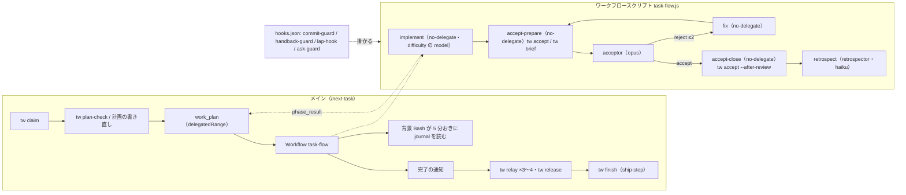

# dynamic workflow（`task-flow`）をハーネスエンジニアリングの観点で診断し、構成の改善を提案する（2026-11-08）

状態: 提案。採否は決めていない。

**この文書は診断と提案であって正典ではない。** tsukumo のタスクの流れ（`/next-task` → Claude Code の dynamic workflows のワークフロースクリプト `task-flow` → `tw finish`）を、
外のハーネスエンジニアリングの一次情報と照らして診断し、良いところは残したまま、変えると効く構成を段階に分けて提案する。
外の一次情報は2つの調査ファイルに分けて置いた: `docs/research/harness-engineering-2026-vendor-guidance.md`（Anthropic・OpenAI の勧め）と
`docs/research/harness-engineering-2026-practice.md`（実務者・他社の事例）。この文書はその要点だけを引く。

## 要約

- **ワークフロースクリプトをオーケストレーターに据えた形（ADR 0045）は、外の勧め（分岐と輪はコードで持つ・検証はハーネスが持つ・独立した評価役・ファイルを記憶に）に合っていて、変えない。**
  切り替え後の7日は送り出し 321 件（前の7日 288）、着手から送り出しまでの中央値 897 秒（前 1026）、`verify_per_task` 2.1（前 2.5）、送り出し時の検証の落ち 10 件（前 19）で、ADR の観察の基準 1・2 を満たす
- **弱いのは4点。** (1) 受け入れ役まで届いた 154 回のうち 88 回（57%）が1回以上差し戻され、1回の差し戻しで1件の所要の中央値が 420 秒から 769 秒に伸びるのに、差し戻しの中身を数える手段が無い（LLM の判定役は実の改善の 38% を却下するという外の測りがあり、正しい差し戻しの割合も分からない）。
  (2) `tw accept` を打つだけの糊の agent が 397 体（全 1,086 体の 37%）起きていて、モデルの指定が無い。(3) 所要の計測が agent の型の名前からの推定に頼り、11月の台帳は「委譲」の start 369 に対して end 326 で、正確な記録 `journal.jsonl` を使っていない。
  (4) メインの手順（計画の確認・5分おきの見張り・完了後の `tw relay` の書き写し）が文章のまま残り、止まった run の掴み直しが7日で 57 件（前 34）に増えた
- **提案は3段。** A（plugin だけで済む小さな手: 糊の agent のモデル指定、`journal.jsonl` からの集計、戻り値を食わせる `tw flow-result`、差し戻しの内訳の集計）、
  B（tsukumo か契約に触る手: 受け入れ・振り返りをプログレスバーの範囲に入れて見張りを外す、糊の agent を hook に移す、受け入れ役への自己申告の扱いを揃える、止まりの輪の抑止）、
  C（判断が要る手: 旧い流れを消す、ワークフローの再試、受け入れの多視点）。A1〜A4 は1日で入り、C1 は観察の基準を数で満たしているので利用者の判断だけが残る

## 1. 材料と取り方

| 材料                                             | 取り方                                                                                                                                    | 数えた日   |
| ------------------------------------------------ | ----------------------------------------------------------------------------------------------------------------------------------------- | ---------- |
| ワークフローの実行の記録 186 run（11-05〜11-08） | `~/.claude/projects/*/*/subagents/workflows/*/journal.jsonl` の `started`・`result` 行と `agent-*.meta.json`、transcript のファイルの時刻 | 2026-11-08 |
| 段の台帳（11月）                                 | 共有の git dir の `task-workflow/flow/2026-11.jsonl`（8,929 行）の `event` ごとの数                                                       | 2026-11-08 |
| 7日の流れの数                                    | `tw metrics --days 7`・`tw metrics --stages`                                                                                              | 2026-11-08 |
| hook の拒否（30日）                              | `node scripts/hook/hook-denial-tally.ts --days 30`                                                                                        | 2026-11-08 |
| 流れの正典                                       | ADR 0045・`docs/architecture/workflow-contract/`・`vendor/tsukumo-plugins` の `workflows/task-flow.js`・`skills/next-task/script-flow.md` | 読んだ     |
| 外の一次情報                                     | 上の2つの調査ファイル（サブエージェントが 2026-11-08 に集めた）                                                                           | 写した     |

run の所要は `journal.jsonl` の作成時刻から最後の書き込みまで、agent ごとの所要は transcript ファイルの作成時刻から最後の書き込みまで。会話の中身（`agent-*.jsonl` の本文）は読んでいない。
`flow` を `script` に切り替えたのは 2026-11-03（`.tw/config.toml` のコミット `24f1fe58e`）なので、`tw metrics --days 7` の「今」はほぼワークフロースクリプトの流れ、「前」はスキルの流れ。

## 2. 外のハーネスエンジニアリングが勧めること（要点）

詳細と出典の URL は2つの調査ファイルにある。ここでは診断に使う原則だけを引き、出典は記事名と日付で示す。

| 原則                                                                                                                                                   | 出どころ                                                                                                                                                                                                                                                                                                                                                |
| ------------------------------------------------------------------------------------------------------------------------------------------------------ | ------------------------------------------------------------------------------------------------------------------------------------------------------------------------------------------------------------------------------------------------------------------------------------------------------------------------------------------------------- |
| ハーネスはモデル以外のすべてで、モデルを固定してもハーネスだけで性能が動く（Terminal-Bench 2.0 で 52.8% → 66.5%）                                      | LangChain「Improving Deep Agents with harness engineering」2026-02-17・「The anatomy of an agent harness」2026-03-10、Böckeler「Harness engineering for coding agent users」2026-04-02                                                                                                                                                                  |
| 予測できる道筋はコードの分岐と輪で持ち、モデルに任せるのは判断が要るところだけ。決定的なノードとエージェントのノードを1つの流れに混ぜる                | Anthropic「Building effective agents」2024-12-19（[anthropic.com](https://www.anthropic.com/engineering/building-effective-agents)）、Anthropic「A harness for every task: dynamic workflows」2026-06-02（同じ文脈で計画と実行をすると完了の誤認・自己評価の甘さ・目標の漂流が起きるので、計画を Claude が書くスクリプトに移す）、Stripe「Minions」2026 |
| 書き込みは1本のスレッドに保ち、ほかのエージェントは判定・相談で知恵を出す                                                                              | Cognition「Multi-Agents: What's Actually Working」2026-04-22、Cursor「Scaling long-running autonomous coding」2026-01-14                                                                                                                                                                                                                                |
| 評価役は生成役と分け、作り手の文脈を共有させない。輪には上限を置く                                                                                     | Anthropic「Building effective agents」（evaluator-optimizer）、Cognition 2026-04-22、LangChain「Organizing context in a multi-agent harness」2026-09-08、Anthropic「Harness design for long-running apps」2026-03-24（評価役はタスクがモデル単独の能力の外にあるときだけ価値がある）                                                                    |
| LLM の判定役は誤る（強い判定役でも実の改善の 38% を却下し、退行の 44% を通す）。判定役は助言に置き、テスト・リンタ・実行結果の決定的な検証を上位に置く | arXiv 2607.25152（2026-07）・arXiv 2609.02246（2026-09）、Marmelab「The state of AI harness engineering 2026」2026-09-24（査読エージェントは弱いか負の結果）                                                                                                                                                                                            |
| 文章の指示より機械の強制。受動的なヒントは読まれずエラーは読まれる。AGENTS.md の指示は当てにならず hooks を使い、エージェントが検査を飛ばす前提で組む  | OpenAI「Harness engineering」2026-02-11、Claude Code「Best practices」（強調を足しても守られない行は hook に移す）、Stripe「AI steering experiments」2026-05-14、Cursor「Towards self-driving codebases」2026-02-05、Böckeler「Maintainability sensors」2026-05-27                                                                                      |
| 進みと状態はファイル・git・課題の置き場に残し、会話の文脈に置かない。長い出力はファイルに書いて要る分だけ読む                                          | Anthropic「Effective harnesses for long-running agents」2025-11（[anthropic.com](https://www.anthropic.com/engineering/effective-harnesses-for-long-running-agents)）、Cursor「Dynamic context discovery」2026-01-06                                                                                                                                    |
| 検証はハーネスが持つ（規則の検査・画面の確認・LLM の判定の3つを組み合わせる）                                                                          | Anthropic「Building agents with the Claude Agent SDK」2025-09-29（[anthropic.com](https://www.anthropic.com/engineering/building-agents-with-the-claude-agent-sdk)）                                                                                                                                                                                    |
| サブエージェントの価値は文脈に入れないことにあり、同時に走らせるのは 2〜4 体。並列に同じファイルを触らせない                                           | Garg「The Orchestrator's Tax」2026-07-16、Cognition「Don't Build Multi-Agents」2025-06-12                                                                                                                                                                                                                                                               |
| ループには外部の背圧と上限を置く（同じファイルの編集回数で堂々巡りを検知する、CI は2周で人へ戻す）                                                     | LangChain 2026-02-17（LoopDetectionMiddleware）、Stripe「Minions」2026、OpenAI Codex docs（auto-review は連続3回で中断）、Huntley「Ralph」2025-07-14（停止条件が無く人が止める）                                                                                                                                                                        |
| 観測の手段（trace・計測）を人とエージェントの両方が読める形で持ち、trace → 仮説つきの変更 → 実験 → 人の承認の改良の輪を回す                            | OpenAI 2026-02、Anthropic「Demystifying evals for AI agents」2026-01-09（ハーネスとモデルを一緒に測る）、LangChain（Trace Analyzer）、Factory「Frontier Harness」2026-10-29（Agent Factory）、Google「The anatomy of harness engineering」、VS Code「Agent harnesses」2026-05-15                                                                        |
| ハーネスの規則は失敗から起こし、各部品は「モデルができないこと」の仮定なので古びたら消す（ガベージコレクション）                                       | Hashimoto「My AI adoption journey」、Anthropic 2026-03-24（新モデルごとに不要になった部品を削る）、OpenAI 2026-02、LangChain 2026-02-17、Factory 2026-10-29                                                                                                                                                                                             |
| 人の介入点は計画の承認・主要なコードの査読・上限に当たったときに寄せる。ハーネスの目的は人を外すことではなく、人の注意を要る所へ向けること             | Böckeler 2026-04-02、Ball（Amp）2026-10-13、Stripe 2026                                                                                                                                                                                                                                                                                                 |

## 3. 今の構成

- 分岐と輪（受け入れの判定による道の分岐、差し戻しの上限2回、`null` での停止）は `task-flow.js` のコードが持つ（`vendor/tsukumo-plugins/workflows/task-flow.js:22`・`:169`〜）
- 実装・直しの model は `difficulty` から（`task-flow.js:100`）、受け入れ役は `agents/acceptor.md` の `opus`、振り返りは `haiku`（`task-flow.js:283`）。受け入れの準備と締めの agent には model の指定が無い（`task-flow.js:205`・`:265`）
- 進みは実装の段ごとの `phase_result` でプログレスバーに出る。受け入れ・振り返りはプログレスバーではメインのフェーズのままで、完了の通知のあとにメインが進める（ADR 0045「3. 帯」）
- 関門は hook（`hooks/hooks.json`）がワークフローの agent にも掛かる。所要の計測は `tw lap-hook` が `SubagentStart`・`SubagentStop` の `agent_type` の名前から段を推定して書く（`skills/task-model/scripts/tw/lap_hook.py:28`）
- 計画の確認と書き直し、5分おきの見張り、完了後の `tw relay` の書き写しと `tw finish` はメインが文章の手順（`skills/next-task/script-flow.md`、7.7KB）で行う

## 4. 良いところ・変えないほうがいいところ

| 残すもの                                                                                     | 外の勧めとの対応                                                         | 根拠                                                                                                                                           |
| -------------------------------------------------------------------------------------------- | ------------------------------------------------------------------------ | ---------------------------------------------------------------------------------------------------------------------------------------------- |
| ワークフロースクリプトが分岐と輪を持つ（ADR 0045）                                           | 予測できる道筋はコードで。計画をスクリプトに移す（Anthropic 2026-06-02） | 切り替え後の7日で所要の中央値 897 秒（前 1026）、`long_delegation` 62（前 113）、`long_handback` 25（前 65）                                   |
| 受け入れ役を書き換えの道具を持たない別の agent（`opus`）にし、輪の上限を2回に置く            | evaluator-optimizer・輪の上限・書き込みは1本のスレッド                   | `agents/acceptor.md`・`task-flow.js:22`。3回差し戻しで止めた run は 186 回中 2 回だけ                                                          |
| 検証の事実を `.check-record.json` の木の SHA で照らし、`tw accept --after-review` が確かめる | 検証はハーネスが持つ                                                     | ADR 0046。自己申告（`verifyPassed`）は早く止めるためだけに使っている                                                                           |
| 前段の結果と再開の位置を Beads（`tw relay`）に置き、会話の文脈に置かない                     | 状態はファイル・課題の置き場に                                           | `docs/architecture/workflow-contract/skill-sequence.md`「受け取るもの」。セッションをまたぐ再開が `tw relay T-xxx 再開` で効く                 |
| 計画の確認と書き直しをワークフローの外（メイン）で済ませてから起こす                         | 偵察してから fan-out する（`workflow-authoring` の勧め）                 | プログレスバーのフェーズ名はメインしか渡せない（契約）。中で書き直すと段の数と名前が届かない（`script-flow.md:10`）                            |
| 関門を hook で掛け、文章の指示は守られなくても hook が止める                                 | 構造的な強制を文章より優先                                               | 30日で `tw-commit-guard` 181 件・`bash-guard` の書き換えの拒否 1,224 件が、違反を起こさず止めている                                            |
| 1件ごとの振り返りがドラフトを積み、週ごとの振り返りが段の所要と規則の発火を読む              | 観測を人と agent の両方が読む・自己改善の輪                              | `docs/history/retrospect.md`: 積んだ 421・採用 370・却下 49。本提案の弱点（台帳の欠け・近道の不使用）も 11-08 の振り返りがドラフトに拾っている |
| 実装の段を1つの作業ツリーで順に走らせ、`isolation: 'worktree'` を使わない                    | 並列に同じファイルを触らせない                                           | ADR 0045「採らなかった案」。未送信のコミットが見えない実測                                                                                     |
| `agent()` が `null` を返したら後の段を走らせず止める                                         | 使用量の上限で失敗したときの切り分け                                     | `task-flow.js:146`〜。止まった段が `tw relay 再開` に残り、次の着手で `from` から続く                                                          |

## 5. 診断

### 5.1 差し戻しが多いのに中身を数える手段が無い

- 186 run のうち受け入れ役まで届いたのは 154 run。差し戻し 0 回が 66、1 回が 67、2 回が 19、3 回（上限で停止）が 2。1回以上は 88 run（57%）
- 受け入れが通った run の所要の中央値は、差し戻し 0 回で 420 秒（n=64）、1 回で 769 秒（n=64）、2 回で 959 秒（n=19）。1回の差し戻しで、直し 125 秒・準備 19 秒・受け入れ役 55 秒の3体が増える
- 差し戻しの `findings` は `journal.jsonl` に残るが、どの種類（完了条件・正しさ・規約・簡素化。`parts/acceptor/acceptor-brief.md` の4種類）がどれだけかを数える手段が無い。
  実装役が最初に読む決まり（`implementer-brief.md`、21.7KB）に何を足し何を消すかは、この内訳が無いと決められない
- 外の勧めとのずれ: 評価の輪はあるが、評価の結果を次の生成の決まりへ戻す経路（観測 → 文書の手直し）が、数ではなく個別の振り返りに頼っている。
  LLM の判定役は実の改善の 38% を却下するという測り（2章）があるので、57% のうちどれだけが正しい差し戻しかも、内訳が無いと分からない

### 5.2 糊の agent が全体の 37% を占める

- 受け入れの準備（`accept-prepare`）260 体・締め（`accept-close`）137 体の計 397 体が、全 1,086 体の 37%。仕事は `tw accept`・`tw brief acceptor`・`tw accept --after-review` を打って出力を schema に写すだけで、所要の中央値は 19 秒・7 秒（全所要の 5.1%）
- `agent()` に `model` が無いのでメインの model を継ぐ（`agent-*.meta.json` に `model` の欄が無い。`workflow-authoring` の「省くとメインの model を継ぐ」から推定）。起動ごとに CLAUDE.md と道具の定義を読む固定費も 397 回払っている
- ワークフロースクリプトがシェルに触れないために LLM を決定的な手順の実行役にしている。外の勧めで言えば「判断の要らないところにモデルを使っている」

### 5.3 計測が agent の型の名前からの推定に頼っている

- 11月の台帳の `lap` は「委譲」start 369・end 326、「レビュー」start 479・end 459、「受け入れ」start 348・end 325。`tw metrics --stages` は `OPEN_TOTAL 22`・`INTEGRITY WARN 委譲=18,レビュー=4` を出し、11-08 の週次の振り返りが「委譲の end を書く hook を足す」ドラフトを積んだ
- 欠ける理由は構造にある。`tw lap-hook` は `SubagentStart` の `agent_type` の末尾が `no-delegate`・`general-purpose` なら「委譲」の start と見なす（`lap_hook.py:28`）が、同じ型の agent を準備・直し・締めにも使うので、ADR 0045 は「偽って書かれる」経路を避ける順番の縛り（`tw accept` を2周目で打たない、締めの agent を挟む）で回避している
- 一方、ワークフローの実行は `journal.jsonl`（`started`・`result`、`label`・`phase`・`agentId`）と `agent-*.meta.json`（`agentType`・`model`）を機械的に残す。label は `implement`・`accept-prepare-n`・`acceptor-n`・`fix-n`・`accept-close`・`retrospect` で役が一意に読め、この文書の数はすべてここから取れた。tsukumo の `tw` も hook もこの記録を読んでいない

### 5.4 メインの文章の手順と止まりの輪

- メインが1サイクルで読む手順は `next-task/SKILL.md` 7.2KB・`script-flow.md` 7.7KB・`task-workflow/completion-report.md` 5.7KB・`ship-step/SKILL.md` 2.8KB。完了の通知のあとは、戻り値を読んで `tw relay` を3〜4回、止まっていれば `tw relay 再開` と `tw release`、通れば `ship-step` を手で打つ（`script-flow.md:45`）
- 進みの見張りは背景の Bash が `sleep 300` で `journal.jsonl` を数える形（`script-flow.md:31`〜）。`Monitor` は tsukumo が新しい事実に数えないので使えない、と手順自身が書いている（`:43`）。tsukumo は `workflow_progress` を読んで `workflow-progress` のイベントにしている（`src/server/session-driver/core/message/sdk-background-message.ts:102`）が、`speak` の新しい事実には数えていない（`src/server/session-driver/core/call-review.ts:86`）
- 止まった run は 186 回中 32 回が implement の1体だけで終わっている（11-05: 5・11-06: 15・11-07: 12）。11-07 16:23〜16:35 には12分で5回続けて止まった run があり、同じタスクを `/loop` が掴み直して同じ所で止まったように見える（同じタスクかは `journal.jsonl` からは読めない。推定）。
  `tw metrics --days 7` の `reclaim`（release のあとの claim）は 57 件で、前の7日の 34 件から増えた
- 外の勧めとのずれ: ハーネスが決められること（戻り値の写し、再開の位置、止まりの回数の上限）をモデルに文章で頼んでいる。Claude Code の Best practices は「強調を足しても守られない行は hook に移す」と書く

### 5.5 受け入れ役に渡すものが決まりと食い違う

- `task-flow.js:221` は実装役の報告（理由・検証・`stepLines`）と直しの報告を受け入れ役の依頼文に足す。受け入れ役の決まり `acceptor-brief.md:11` は「渡されるのは差分・完了条件・規約・画像だけ（委譲先の自己申告は無い）」と書く
- どちらが正しいかはこの文書では決めない。決まりと実装のどちらかに揃えないと、受け入れ役が自己申告に流される経路と、決まりを読んだ受け入れ役が渡されたものを無視する経路の両方が残る
- 外の勧めは決まりの側にある。Cognition（2026-04-22）は「査読役は作り手と事前に文脈を共有しないとき最もよく働く」と書き、LangChain（2026-09-08）は検証役を isolated（課題の文だけ渡す）にしている

### 5.6 旧い流れが観察の基準を満たしてなお残る

- ADR 0045「6. 観察の基準」は、ワークフロースクリプトの流れで 10 件送り出し、所要の中央値が基準線の 1.25 倍以内・`verify_per_task` と `ship_verify_failed` が基準線以下・差し戻しの合計が +2 以内・切り戻しに当たらない、の4つ
- 11月の台帳では `ship` の `SHIPPED` が 292 件（切り替えは 11-03）。`tw metrics --days 7` は所要の中央値 897 秒（前 1026）、`verify_per_task` 2.1（前 2.5）、`ship_verify_failed` 10（前 19）。基準 1・2・4 は満たす。基準 3 は旧い流れの差し戻しを同じ数え方で取る手段が無く未比較
- 残っている二重の正典: `skills/task-workflow/`・`implement-step`・`accept-step`・`retrospect-step`・`ship-step`（skills の Markdown は全体で 437KB）、`tw escalate-check`（7日で `escalate_suggest` 163 件が発火。ADR は「消す」と決めた）、`tw handback-guard` の返却の形の検査（30日で 387 件の拒否。ワークフローの流れでは schema が置き換える）。消す作業は3件のタスクとして hold にある
- 外の勧めとのずれ: 読まれなくなった文書・使われない分岐のガベージコレクションが、決めた条件を満たしたあとも止まっている。Anthropic（2026-03-24）も「新モデルごとに不要になった部品を削る」と書く

### 5.7 ハーネスの変更を測る再試が無い

- `docs/architecture/testing/harness-replay.md` のタスクの再試は `claude -p` を1回起こすだけで、委譲・受け入れ・振り返りの流れそのものは再試しない（「再試しないもの」）
- 11-01 の試作では、凍結した2件を一時の作業ツリーでワークフロースクリプトに流して比べた（`docs/research/workflow-script-trial.md`）が、道具にはなっていない。A〜C の変更の効果は入れたあとの週次の数でしか分からない

## 6. 提案

段階 A は plugin（`tsukumo-plugins`）だけで済み、契約も tsukumo のコードも触らない。B は tsukumo か契約に触る。C は利用者の判断が要る。

### A. 小さく・すぐ（plugin だけ）

| #   | 提案                                                                                                                                                                                                                                                                                                                                                                                                                  | 効く弱点 | 触る場所                                                    |
| --- | --------------------------------------------------------------------------------------------------------------------------------------------------------------------------------------------------------------------------------------------------------------------------------------------------------------------------------------------------------------------------------------------------------------------- | -------- | ----------------------------------------------------------- |
| A1  | 受け入れの準備・締めの `agent()` に `model: "haiku", effort: "low"` を付ける。仕事は `tw` の出力を schema に写すだけで判断が無い。B2 が入るまでのつなぎ                                                                                                                                                                                                                                                               | 5.2      | `task-flow.js:205`・`:265`                                  |
| A2  | 完了の通知のあとにメインが打つ1コマンド（A3）に run の `Transcript dir` を渡し、`journal.jsonl` と `agent-*.meta.json` から段の所要・差し戻しの回数・止まった段を台帳に書く（読むのは `label`・`phase`・`agentId`・時刻・`agentType`・`verdict` だけ。会話の本文は読まない）。`tw lap-hook` の型の名前からの推定は、ワークフローの流れでは要らなくなる。「委譲の end を書く hook を足す」ドラフトはこの形で閉じられる | 5.3      | `tw` に新しいサブコマンド、`tw metrics --stages` の出どころ |
| A3  | `tw flow-result <ID> --json-file -` を足し、ワークフローの戻り値の JSON を食わせる。`tw relay` の 実装・受け入れ・振り返り・再開 を tw が書き、`stopped` なら `tw release` まで打ち、通れば `FINISH_READY` の1行を返す。`script-flow.md` の手順4は「戻り値を渡す → 出た行に従う」の2行になる                                                                                                                          | 5.4      | `tw` に新しいサブコマンド、`script-flow.md:45`              |
| A4  | A2 の集計に、差し戻しの `findings` の件数と4種類（完了条件・正しさ・規約・簡素化）の内訳を run ごとに足し、週次の振り返りの材料「規則の発火」の隣に並べる。内訳が出たら、多い種類の決まりを `implementer-brief.md` に足すか、機械の検査（`tw step` の `step_check`）へ移す                                                                                                                                            | 5.1      | A2 と同じサブコマンド、`skills/retrospect/` の材料          |

### B. 中くらい（tsukumo か契約に触る）

| #   | 提案                                                                                                                                                                                                                                                                                                                                                                                                                                                          | 効く弱点 | 触る場所                                                                   |
| --- | ------------------------------------------------------------------------------------------------------------------------------------------------------------------------------------------------------------------------------------------------------------------------------------------------------------------------------------------------------------------------------------------------------------------------------------------------------------- | -------- | -------------------------------------------------------------------------- |
| B1  | 受け入れ・振り返りも `delegatedRange` の範囲に入れ、受け入れ役の判定のあとの agent と振り返りの agent が `phase_result`（`summary` つき）と `speak` を呼ぶ。`phase_result` の戻りが新しい事実になるので `speak` は差し戻されない（試作の記録で確認済み）。これで `script-flow.md` 3a の背景 Bash の見張りを外せる。tsukumo 側で解くなら、`workflow-progress`（既に読んでいる）を `progress-nudged` と同じ差し込みに乗せる（`progress-nudge.ts`）。どちらか1つ | 5.4      | plugin なら `task-flow.js`・`tw plan-phases` の範囲、tsukumo なら契約      |
| B2  | 受け入れの準備・締めを hook に移す。`SubagentStart`（matcher `acceptor`）で `tw accept <ID>` と `tw brief acceptor` を打ち、出力を `additionalContext` で受け入れ役に渡す。`SubagentStop`（acceptor、判定 accept）で `tw accept --after-review`。ID は着手の控えが1件の作業ツリーから `tw` が読む（`lap-hook` と同じ前提）。397 体の起動が消える                                                                                                              | 5.2・5.3 | `hooks/hooks.json`・`tw`、`task-flow.js` から準備・締めの `agent()` を消す |
| B3  | 受け入れ役に実装役の自己申告を渡すかを決め、決まりと実装を揃える。推すのは `acceptor-brief.md:11` に合わせて自己申告を外し、機械の事実（`tw accept` の `SNAPSHOT`・`verify-check` の結果・`STEPPED` の行数）だけを渡す形。2周目に前回の指摘の原文を渡すのは残す                                                                                                                                                                                               | 5.5      | `task-flow.js:221`・`acceptor-brief.md`                                    |
| B4  | 止まりの輪の抑止。`tw claim`（または `/loop` の `tw loop-check`）に「同じタスクが `再開` の relay を持ったまま2回止まったら `hold` にして人に回す」を足す。`reclaim` 57 件（前 34）と12分で5回の連続停止が根拠。止まった理由（`reason`）は A3 が relay に残すので、hold の本文にそのまま写せる。外の先例は LangChain の堂々巡りの検知、Stripe の「CI は2周で人へ戻す」、Codex の auto-review の「連続3回で中断」（2章）                                       | 5.4      | `tw claim`・`tw loop-check`                                                |

### C. 判断が要る

| #   | 提案                                                                                                                                                                                                                                                                                                                                                 | 効く弱点 | 判断する人・材料                                                             |
| --- | ---------------------------------------------------------------------------------------------------------------------------------------------------------------------------------------------------------------------------------------------------------------------------------------------------------------------------------------------------- | -------- | ---------------------------------------------------------------------------- |
| C1  | 旧い流れを消す（hold の3件を解く）。ADR 0045 の観察の基準のうち 1・2・4 は数で満たし、3 は同じ数え方の手段が無い。消すと `skills/task-workflow/`・段のスキル4件・`tw escalate-check`・`tw handback-guard` の返却の検査が外れ、`tw brief` は決まりの置き場を `workflows/` の隣へ移す（ADR「4. 残す・消す・書き換える」）                              | 5.6      | 利用者。基準 3 を未比較のまま進めてよいかの判断                              |
| C2  | ワークフローの再試。凍結した数件のタスクを一時の作業ツリーで `task-flow` に流し、差し戻しの回数・所要・合否を出す道具を `scripts/dev/` に置く。A・B の変更を入れる前に効果を測る。費用は1件 400〜800 秒・agent 5〜8 体                                                                                                                               | 5.7      | 利用者。費用（サブスクリプションの枠）と、週次の振り返りの材料にするかの判断 |
| C3  | 受け入れの多視点。`opus` の難しさだけ、完了条件の視点と規約の視点の受け入れ役を並列に起こし、コードで合流する（`workflow-authoring` の perspective-diverse verify）。費用が倍になるうえ、LLM の査読役を増やす手は外の測りでは効果が弱いか負（2章）なので、A4 の内訳で多い種類を `tw step` の機械の検査へ移す手を先にし、それでも残る種類にだけ考える | 5.1      | A4 の数が出てから。見送りの可能性が高い                                      |

### 入れる順

1. A1〜A4（1日。plugin の `check_repo.py` の自己テストに A2・A3 の `tw` のサブコマンドを足す）
2. B3（決まりの一致。半日）→ B4（止まりの輪。半日）
3. B1 か tsukumo 側の差し込みのどちらかを選んで入れる（1〜2日）
4. C1 を利用者が決める。決めたら hold の3件を解く
5. B2 は hook の `additionalContext` が使えると確かめてから（下の「確かめていないこと」）
6. C2・C3 は A4 の数が出てから

## 7. 確かめていないこと

| 主張                                                                                         | 確度   | 確かめ方                                                                                                                         |
| -------------------------------------------------------------------------------------------- | ------ | -------------------------------------------------------------------------------------------------------------------------------- |
| 受け入れの準備・締めの agent はメインの model で走っている                                   | 推定   | `agent-*.meta.json` に `model` が無い＝上書き無し。実機で `tsukumo` のメインの model を変えて meta の `pickedEffortModel` を見る |
| 12分で5回続けて止まった run は同じタスク                                                     | 推定   | 台帳 `flow/2026-11.jsonl` の 11-07 16:20〜16:40 の `claim`・`release` の `task` を読む                                           |
| `SubagentStart` の hook が `additionalContext` を返せる（B2 の前提）                         | 未確認 | Claude Code の hooks の文書の `SubagentStart` の出力の欄を読み、使い捨ての hook で確かめる                                       |
| 受け入れ・振り返りを `delegatedRange` に入れても `tw plan-phases` のグループが崩れない（B1） | 未確認 | 着手の印が立ったタスクで `tw plan-phases --through 実装` の JSON を見て、範囲の数を増やした `work_plan` が差し戻されないか試す   |
| 旧い流れの差し戻しの合計（基準 3）                                                           | 未測定 | 旧い流れの台帳で続く2つの `review` の `start` の間に `verify` かコミットが挟まる組を数える（試作の記録の数え方）                 |
| 差し戻しの4種類の内訳                                                                        | 未測定 | A4 のサブコマンドを足して出す                                                                                                    |
| 糊の agent を `haiku` にしても `tw accept` の判定の行を schema に正しく写す（A1）            | 未確認 | 10 run 流して `kind` の値と `tw accept` の最後の行を照らす                                                                       |
| OpenAI「Harness engineering」の日付 2026-02-11                                               | 推定   | 調査ファイル vendor-guidance の8章（本文は 403 でプロキシ経由で読み、日付は検索結果の一致から）                                  |

## 出典

- `docs/architecture/adr/0045-workflow-script-orchestration.md`（決めたこと・観察の基準・置き換えの順）
- `docs/research/agent-harness-adoption-2026-11-01.md`・`docs/research/workflow-script-trial.md`（前の調査と試作の記録）
- `docs/architecture/workflow-contract/skill-sequence.md`・`port-and-return.md`（契約）
- `vendor/tsukumo-plugins/workflows/task-flow.js`・`skills/next-task/script-flow.md`・`hooks/hooks.json`・`skills/task-model/scripts/tw/lap_hook.py`・`skills/task-workflow/parts/acceptor/acceptor-brief.md`
- `docs/history/retrospect.md`（週次の振り返りの記録）
- `docs/research/harness-engineering-2026-vendor-guidance.md`・`docs/research/harness-engineering-2026-practice.md`（外の一次情報）
- Anthropic engineering: [Building effective agents](https://www.anthropic.com/engineering/building-effective-agents)・[Effective harnesses for long-running agents](https://www.anthropic.com/engineering/effective-harnesses-for-long-running-agents)・[Building agents with the Claude Agent SDK](https://www.anthropic.com/engineering/building-agents-with-the-claude-agent-sdk)・[Effective context engineering for AI agents](https://www.anthropic.com/engineering/effective-context-engineering-for-ai-agents)
- 2026 年の一次情報: [Harness design for long-running apps](https://www.anthropic.com/engineering/harness-design-long-running-apps)・[A harness for every task: dynamic workflows](https://claude.dev/blog/a-harness-for-every-task-dynamic-workflows-in-claude-code/)・[Claude Code Best practices](https://code.claude.com/docs/en/best-practices)・[OpenAI Harness engineering](https://openai.com/index/harness-engineering/)・[Cognition Multi-Agents: What's Actually Working](https://cognition.com/blog/multi-agents-working)・[LangChain Improving Deep Agents with harness engineering](https://www.langchain.com/blog/improving-deep-agents-with-harness-engineering)・[Böckeler Maintainability sensors](https://martinfowler.com/articles/sensors-for-coding-agents.html)（ほかの URL は2つの調査ファイル）
